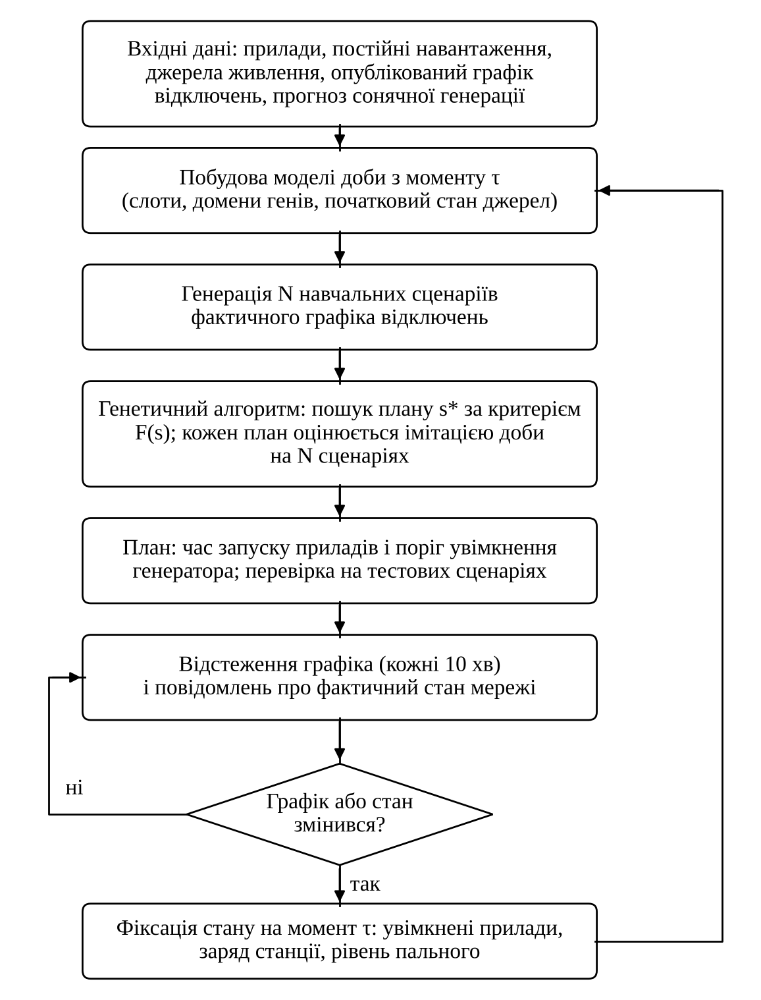
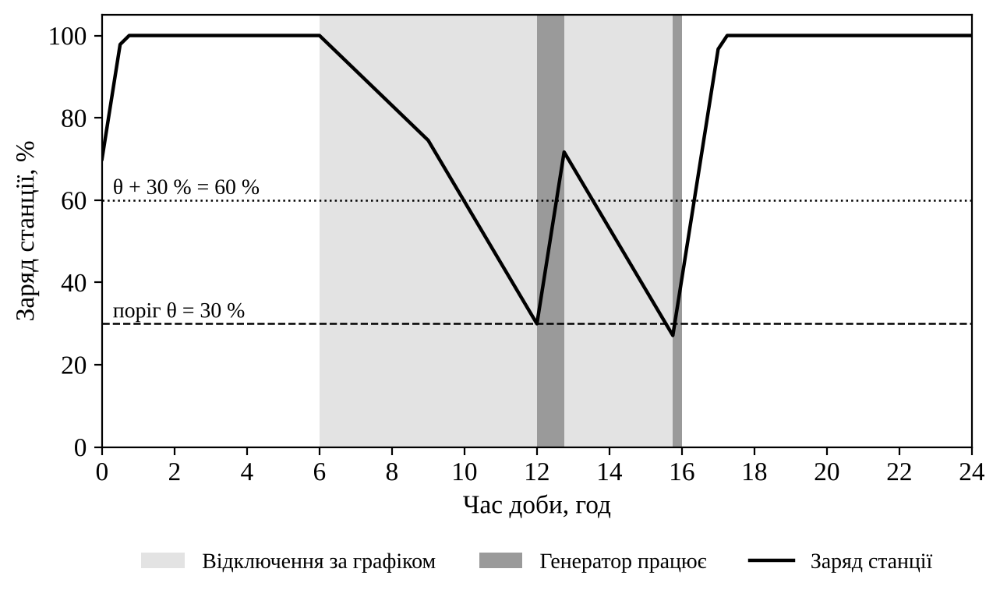
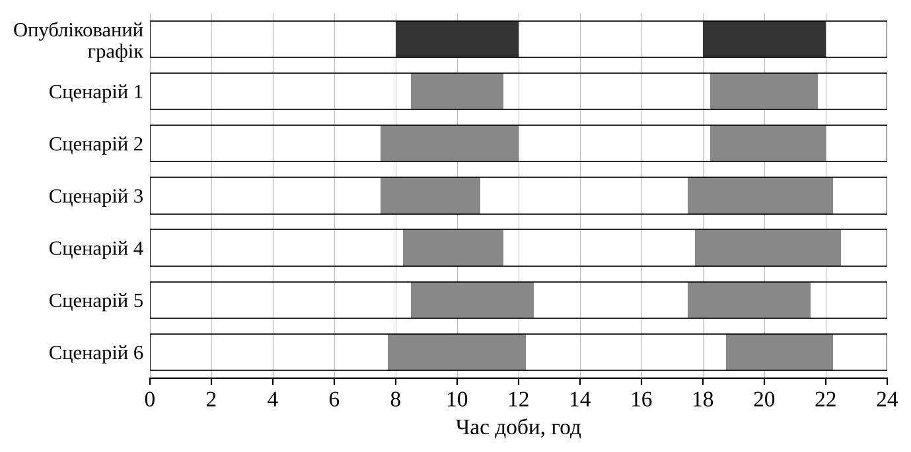
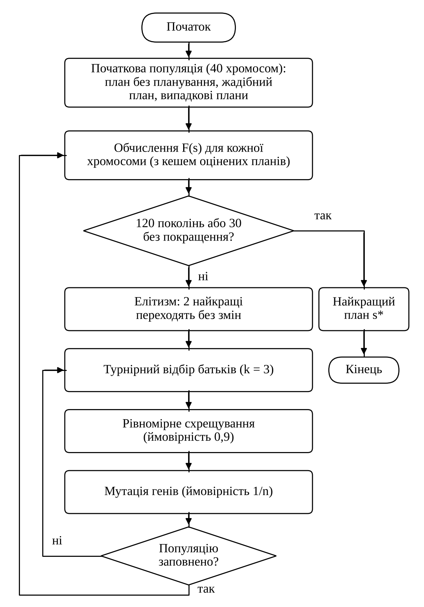
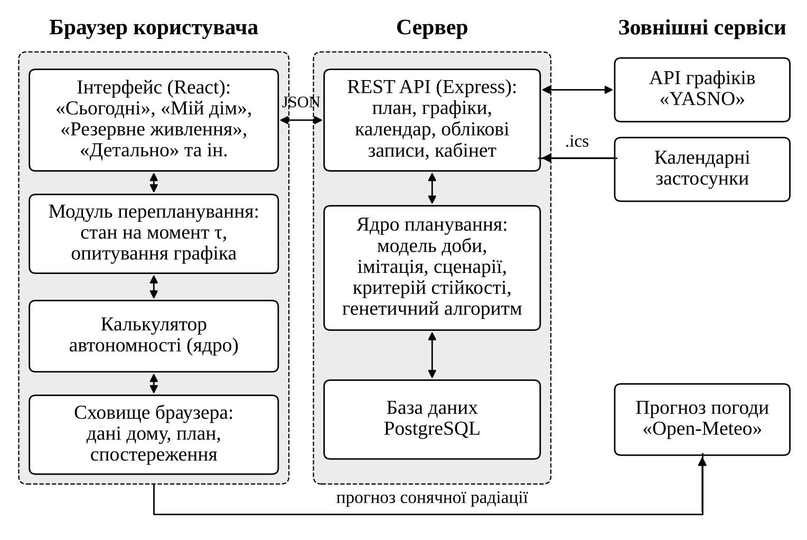

# РОЗДІЛ 2. МОДЕЛЬ І МЕТОД СТІЙКОГО ПЛАНУВАННЯ ЕНЕРГОСПОЖИВАННЯ ДОМОГОСПОДАРСТВА ТА ПРОЕКТУВАННЯ ВЕБ-СЕРВІСУ

## 2.1 Загальна схема методу планування

У підрозділі 1.6 задачу сформульовано так: вибрати на добу вперед час запуску зсувних приладів і режим роботи резервних джерел, знаючи графік відключень лише приблизно. Для її розв'язання в роботі запропоновано метод, що складається з чотирьох частин: імітаційної моделі доби домогосподарства, моделі невизначеності графіка, критерію стійкості плану і генетичного алгоритму, який шукає план за цим критерієм. П'ятою частиною є правило перебудови плану, коли графік або фактичний стан змінився протягом доби. Загальну схему методу наведено на рис. 2.1.

Головне рішення, яке визначило побудову методу, стосується способу обчислення якості плану. Цільову функцію можна було б записати аналітично, як це зроблено в моделях лінійного і змішаного цілочисельного програмування [@mohsenian; @emhass]. Проте в задачі цієї роботи є кілька залежностей, які лінійно описати важко: навантаження обслуговуються в порядку пріоритету, прилад, якому забракло потужності, втрачає весь цикл, генератор вмикається і вимикається за станом станції, а витрата пального залежить від навантаження. Тому якість плану в роботі обчислюється імітацією доби: модель крок за кроком відтворює, що станеться з приладами і джерелами, якщо виконати план за заданого графіка. Такий підхід, як зазначено в підрозділі 1.4, природно поєднується з еволюційними алгоритмами, яким не потрібна аналітична форма цільової функції [@jin; @beyer].

Імітація за одним графіком відповідає на питання, наскільки добрий план, якщо графік буде дотримано. Щоб оцінити, як план витримує зміни графіка, ту саму імітацію виконують на множині сценаріїв фактичного графіка, згенерованих з опублікованого. Отримані значення штрафу зводяться до одного числа критерієм, який враховує і середній результат, і результат у найгірших сценаріях. Генетичний алгоритм порівнює плани саме за цим числом.

Нижче послідовно описано модель доби (підрозділи 2.2–2.4), модель невизначеності (2.5), критерій стійкості (2.6), генетичний алгоритм (2.7) і перебудову плану (2.8). У підрозділі 2.9 наведено проект веб-сервісу, який реалізує метод.

## 2.2 Математична модель доби домогосподарства

Доба поділяється на T = 96 інтервалів (далі слотів) тривалістю Δ = 15 хв, і всі величини в межах слоту вважаються сталими. Графіки відключень публікуються з точністю до пів години, а найкоротші цикли приладів, наприклад закип'ятити чайник, тривають близько 15 хв, тому такий крок не втрачає інформації з графіка і дає змогу планувати короткі прилади. Дискретне подання часу є звичайним для моделей керування енергоспоживанням будинку [@beaudin]. Якщо графік на завтра вже відомий, горизонт планування збільшується до 48 год (T = 192). Це потрібно, щоб увечері станція заряджалася з урахуванням відключення завтра вранці.

Доступність мережі в слоті t описується величиною g_t, що дорівнює 1, коли за графіком світло є, і 0, коли його немає. Коли світло є, сумарна потужність обмежена лімітом вводу P_{grid}.

Навантаження, як і в підрозділі 1.2, поділено на дві групи. Постійне навантаження j має потужність P_j, пріоритет w_j від 1 до 5 і години роботи, задані ознакою a_{jt} (1, якщо в слоті t навантаження має працювати). Зсувний прилад i має потужність P_i, тривалість циклу d_i слотів, вікно, у якому цикл має відбутися (не раніше слоту e_i і закінчитися не пізніше слоту l_i), бажаний час запуску p_i, пріоритет w_i і ознаку b_i, чи можна живити прилад від станції. Ознака b_i потрібна для потужних приладів на зразок бойлера чи духовки, які перевищують потужність інвертора станції або розряджають її за пів години. Цикл приладу не можна переривати: якщо прилад зупинився, вважається, що він не відпрацював. Такий поділ на некеровані та непереривні зсувні навантаження прийнято в моделях керування енергоспоживанням будинку [@beaudin; @zhou].

Змінною рішення для приладу i є номер слоту запуску s_i. Він вибирається з множини

S_i = {e_i, e_i + 1, …, l_i − d_i} ∪ {−1}, (2.1)

де e_i – найраніший слот запуску;

l_i – слот, до якого цикл має закінчитися;

d_i – тривалість циклу в слотах;

−1 – рішення не вмикати прилад сьогодні.

Варіант «не вмикати» потрібен, бо за довгих відключень іноді краще перенести прання на інший день, ніж розрядити станцію, від якої живиться холодильник. Такий варіант штрафується, але він дозволений. Позначення вхідних даних моделі зведено в табл. 2.1.

Таблиця 2.1 – Позначення вхідних даних моделі доби

| Позначення | Зміст | Одиниця |
|---|---|---|
| T, Δ | Кількість слотів і тривалість слоту | –, год |
| g_t | Наявність світла в слоті t за графіком | 0 або 1 |
| P_{grid} | Ліміт потужності вводу | Вт |
| P_j, w_j, a_{jt} | Потужність, пріоритет і години роботи постійного навантаження j | Вт, –, 0 або 1 |
| P_i, d_i | Потужність і тривалість циклу приладу i | Вт, слотів |
| e_i, l_i, p_i | Вікно роботи і бажаний час запуску приладу i | номер слоту |
| w_i, b_i | Пріоритет приладу i і дозвіл живити його від станції | –, 0 або 1 |
| E_{max}, E_{min}, E_0, E_{target} | Ємність станції, мінімально допустимий, початковий і бажаний на кінець доби заряд | Вт·год |
| P_{ch}, P_{inv} | Потужність заряджання і потужність інвертора станції | Вт |
| η_{ch}, η_{dis} | ККД заряджання і розряджання | – |
| P_g, t_{50}, f_g | Номінальна потужність генератора, час роботи на повному баку при навантаженні 50 % і рівень пального | Вт, год, частка бака |
| P_{peak}, H, t_r, t_s | Пікова потужність сонячних панелей, кількість пікових сонячних годин, час сходу і заходу сонця | Вт, год, год |

Окремих змінних для станції модель не містить. Тарифи в задачі не розглядаються, а станція заряджається лише з потужності, що лишилася після обслуговування навантажень. Тому заряджати її від мережі чи сонця, коли є надлишок, ніколи не гірше, ніж не заряджати. Заряджання від генератора коштує пального, але коли генератор працює, визначає правило керування ним, описане в підрозділі 2.3. Розряджається станція лише тоді, коли інших джерел не вистачає. Отже, режим станції однозначно визначається планом приладів і графіком, і вибір має сенс робити тільки для генератора.

## 2.3 Моделі резервних джерел живлення

*Зарядна станція.* Якщо в домогосподарстві кілька станцій, для планування їх зводять в одну еквівалентну: ємності, потужності заряджання й інвертора додаються, а заряд обчислюється як середній, зважений за ємністю. Під час відключення станція може віддати потужність

P_{bat,t} = min(P_{inv}, (E_t − E_{min})·η_{dis} / Δ), (2.2)

де E_t – енергія в станції на початку слоту t;

P_{inv} – потужність інвертора;

E_{min} – мінімально допустимий заряд;

η_{dis} – ККД розряджання.

Перший аргумент обмежує потужність, другий не дає розрядити станцію нижче E_{min} за один слот. Енергія в станції змінюється за формулою

E_{t+1} = E_t + η_{ch}·c_t·Δ − q_t·Δ / η_{dis}, (2.3)

де c_t – потужність заряджання в слоті t;

q_t – потужність, яку станція віддає навантаженням;

η_{ch} – ККД заряджання.

Потужність заряджання дорівнює

c_t = max(0, min(P_{ch}, R_t − L_t, (E_{max} − E_t) / (η_{ch}·Δ))), (2.4)

де R_t – потужність усіх джерел, крім станції, у слоті t (мережі, сонячних панелей і працюючих генераторів);

L_t – потужність обслужених у слоті навантажень.

Під час відключення станція, отже, заряджається від генератора або сонця, якщо їхня потужність перевищує потреби навантажень. Значення ККД за замовчуванням η_{ch} = 0,95 і η_{dis} = 0,92 прийнято автором як типові для портативних станцій. Ємність користувач вводить сам і може вказати корисну, а не заявлену, бо за випробуваннями [@stasiv] корисна ємність становить від 70 до 93 % заявленої.

*Паливний генератор.* Генератор g має номінальну потужність P_g і бак, якого вистачає на t_{50} годин роботи при навантаженні 50 % номіналу. Цю величину виробники зазвичай вказують у паспорті, тому вона зручна для введення. Рівень пального f_g вимірюється в частках бака. У програмі «HOMER» витрату пального генератора описують лінійною функцією від вихідної потужності з ненульовим вільним членом, тобто генератор споживає пальне і на холостому ходу [@homerfuel]. У роботі прийнято таку саму форму залежності у відносних величинах. Витрата пального за слот дорівнює

Δf_{g,t} = (Δ / t_{50})·q(x_t) / q(0,5), (2.5)

де x_t – завантаження генератора (відношення вихідної потужності до номінальної);

q(x) – відносна витрата пального при завантаженні x, що обчислюється за формулою

q(x) = 0,25 + 0,75·x. (2.6)

Нормування на q(0,5) забезпечує, що при навантаженні 50 % повного бака вистачає саме на t_{50} годин. Частку 0,25 витрати на холостому ходу прийнято автором для невеликих побутових генераторів. Її можна уточнити за паспортними даними конкретної моделі, і це не змінює решти моделі.

Генератор працює лише під час відключення і керується правилом із порогом θ. Якщо в домогосподарстві є станція, генератор вмикається, коли її заряд опускається до θ, і вимикається, коли станція зарядилася до рівня

θ_{off} = min(95 %, θ + 30 %), (2.7)

або коли закінчилося пальне чи повернулося світло. Без станції генератор вмикається на початку відключення і працює до його кінця або до кінця пального. Різниця між порогами увімкнення і вимкнення (гістерезис) не дає генератору вмикатися і вимикатися кожні кілька хвилин, і після запуску він працює стільки, скільки потрібно, щоб дозарядити станцію на 30 %. Подібно працює стратегія циклічного заряджання в «HOMER»: генератор, якщо вже запущений, заряджає акумулятор до заданого рівня заряду [@homercycle].

Поріг θ вибирається з множини {0 %, 5 %, …, 100 %}, до якої додано рішення «не вмикати генератор». Саме θ, а не час увімкнення, є змінною рішення, бо правило з порогом реагує на фактичний заряд станції. Якщо відключення почалося раніше або триває довше, генератор увімкнеться тоді, коли станція справді розрядиться, а не в заздалегідь визначену годину. Приклад роботи генератора за порогом θ = 30 % під час десятигодинного відключення показано на рис. 2.2.

*Сонячні панелі.* Генерація панелей у слоті t задається напівсинусоїдою між сходом t_r і заходом t_s сонця:

S_t = min(k·P_{peak}, A·sin(π·(h_t − t_r) / (t_s − t_r))), (2.8)

де h_t – середина слоту t у годинах, t_r < h_t < t_s (поза цим проміжком S_t = 0);

k = 0,75 – коефіцієнт втрат (нагрів, забруднення, інвертор, неоптимальний кут);

A – амплітуда, що обчислюється з умови, щоб енергія за добу дорівнювала k·P_{peak}·H:

A = π·k·P_{peak}·H / (2·(t_s − t_r)). (2.9)

Тут H – кількість пікових сонячних годин, тобто денна сума сонячного випромінювання на горизонтальну поверхню, виражена в годинах при 1 кВт/м². Цю величину сервіс бере з прогнозу «Open-Meteo»: денна сума короткохвильового випромінювання на горизонтальну поверхню в МДж/м², поділена на 3,6, дає кількість кіловат-годин на квадратний метр, тобто H [@openmeteo]. Звідти ж беруться години сходу і заходу сонця. Якщо прогноз недоступний, береться типове для поточного місяця значення H, а користувач може і сам задати H для своїх панелей. Наближення добового ходу випромінювання за денною сумою і тривалістю дня розглянуто в [@duffie]; у роботі використано найпростіше з них, напівсинусоїду. Для похилих панелей реальна генерація зазвичай трохи більша, тож оцінка консервативна. Точнішої форми добової кривої модель не потребує, бо для плану важливо передусім, скільки енергії дадуть панелі за день і в які години.

На рис. 2.2 заряд станції спадає від початку відключення о 06:00. О 12:00 він досягає порогу 30 %, генератор вмикається, живить навантаження і заряджає станцію, поки заряд не перевищить 60 % (через крок 15 хв заряд встигає дійти до 72 %). Удруге генератор вмикається о 15:45 і вимикається о 16:00, коли повертається світло. За ці дві короткі роботи витрачено приблизно 11 % бака.

## 2.4 Імітація доби і цільова функція

Імітація виконується для заданого плану s, тобто часу запуску всіх приладів і порогів усіх генераторів, і заданого графіка g. Для кожного слоту t послідовно виконуються такі дії.

Спершу визначається стан генераторів за правилом з підрозділу 2.3 і сумарна доступна потужність

C_t = g_t·P_{grid} + S_t + Σ_g u_{g,t}·P_g + (1 − g_t)·P_{bat,t}, (2.10)

де u_{g,t} – 1, якщо генератор g працює в слоті t, і 0 – якщо ні;

P_{bat,t} – потужність, яку може віддати станція, за формулою (2.2).

Потім навантаження, які мають працювати в цьому слоті, обслуговуються в порядку спадання пріоритету, а за рівного пріоритету постійні навантаження обслуговуються раніше за прилади. Навантаження отримує живлення, якщо його потужність ще вміщується в C_t. Постійне навантаження, якому не вистачило потужності, вимикається лише на цей слот. Прилад, якому не вистачило потужності, зупиняється, його цикл вважається зіпсованим, і далі в цей день він не працює. Прилад з b_i = 0 під час відключення може працювати тільки від генератора; якщо генератор не працює, такий прилад теж зупиняється.

Насамкінець складається енергобаланс слоту. Першою використовується енергія сонця, потім мережі або генератора, а станція покриває решту під час відключення і заряджається з надлишку за формулами (2.3) і (2.4). Витрата пального оновлюється за формулою (2.5).

Такий порядок обслуговування відповідає тому, як поводиться людина під час відключення: спершу живлення отримують холодильник і роутер, а потужні прилади вмикають, лише коли вистачає потужності. Він не завжди оптимальний у суворому сенсі. Наприклад, іноді вигідніше вимкнути освітлення на чверть години, щоб не перервати прання. Але план, побудований на такій моделі, людина може виконати без додаткових розрахунків.

Результатом імітації є кількість годин, протягом яких кожне постійне навантаження було без живлення, перелік приладів, що не відпрацювали, заряд станції в кінці горизонту і витрачене пальне. З них обчислюється штраф плану

J(s, g) = c_1·J_1 + c_2·J_2 + c_3·J_3 + c_4·J_4 + c_5·J_5, (2.11)

де J_1 = Σ_j w_j·V_j – зважена тривалість вимкнення постійних навантажень, год, а V_j – тривалість вимкнення навантаження j;

J_2 = Σ_i w_i·z_i – зважена кількість приладів, що не відпрацювали, де z_i дорівнює 1, якщо прилад i перерваний або не запланований, і 0, якщо відпрацював;

J_3 = Σ_i w_i·|s_i − p_i|·Δ – зважене відхилення запуску приладів від бажаного часу, год (враховується лише для приладів, що відпрацювали);

J_4 = max(0, E_{target} − E_T) / E_{max} – недозаряд станції в кінці горизонту в частках ємності, де E_T – заряд станції в кінці горизонту;

J_5 = Σ_g F_g – пальне, витрачене всіма генераторами, у частках бака;

c_1…c_5 – вагові коефіцієнти.

Штраф (2.11) поєднує п'ять різних за природою показників зваженою сумою. Зважена сума – найпростіший спосіб звести кілька критеріїв до одного, і її розв'язок є Парето-оптимальним за додатних ваг [@marler]. Недолік цього способу в тому, що ваги доводиться вибирати, і від цього вибору залежить план [@marler]. Тому значення коефіцієнтів у табл. 2.2 підібрано так, щоб їхнє співвідношення мало зрозумілий зміст.

Таблиця 2.2 – Вагові коефіцієнти цільової функції

| Коефіцієнт | Значення | За що нараховується штраф |
|---|---|---|
| c_1 | 1 | Година без живлення постійного навантаження (множиться на його пріоритет) |
| c_2 | 10 | Прилад не відпрацював (множиться на пріоритет) |
| c_3 | 0,3 | Година відхилення від бажаного часу запуску (множиться на пріоритет) |
| c_4 | 20 | Недозаряд станції в кінці горизонту відносно бажаного рівня, частка ємності |
| c_5 | 8 | Витрачений повний бак генератора (пальне, шум, знос) |

За цих значень зіпсований цикл приладу важить стільки ж, скільки десять годин без живлення постійного навантаження того самого пріоритету, а зсув запуску на три години – приблизно стільки, скільки одна година без живлення. Недозаряд станції на половину ємності коштує як зіпсований цикл приладу з пріоритетом 1, а повний бак генератора – трохи менше. Отже, найбільше метод уникає переривання приладів, далі вимкнення важливих навантажень, і лише потім зважає на зручність і пальне. Користувач впливає на цей баланс через пріоритети приладів, які задає сам, тож змінювати коефіцієнти йому не потрібно.

## 2.5 Модель невизначеності графіка відключень

У підрозділі 1.1 показано, що опублікований графік змінюється: за перші п'ять днів збору даних «YASNO» для цієї роботи 40 % графіків для Києва змінилися вже після публікації [@yasno]. Крім того, оператор може запровадити аварійні відключення, які діють поза графіком [@lb]. Тому графік у моделі розглядається не як точно відомі дані, а як прогноз, навколо якого можливі відхилення трьох видів:

– зсув початку і кінця відключення;

– скасування запланованого відключення;

– додаткове позапланове відключення.

Фактичний графік (сценарій) ω будується з опублікованого так. Для кожного запланованого відключення з проміжком [a, b) з ймовірністю p_{cancel} воно скасовується. Якщо ж ні, його початок і кінець зсуваються на незалежні випадкові величини

δ = max(−δ_{max}, min(δ_{max}, ξ)), ξ ~ N(0, σ²), (2.12)

де σ – стандартне відхилення зсуву;

δ_{max} – найбільший допустимий зсув;

ξ – нормально розподілена випадкова величина, округлена до цілого числа слотів.

Нові межі відключення дорівнюють

a′ = a + δ_a, b′ = max(a′ + Δ, b + δ_b), (2.13)

де δ_a, δ_b – зсуви початку і кінця за формулою (2.12).

Друга частина формули (2.13) гарантує, що відключення не зникне і не матиме від'ємної тривалості, навіть якщо кінець зсунувся раніше за початок. Окремо з ймовірністю p_{extra} на кожну добу горизонту додається позапланове відключення тривалістю від 1 до 3 год з випадковим початком. Нормальний розподіл зсуву вибрано як найпростіший симетричний розподіл з двома параметрами. Обмеження ±δ_{max} відкидає нереалістично великі зсуви, які в моделі краще описувати скасуванням або додатковим відключенням.

Параметри моделі задано для трьох рівнів невизначеності (табл. 2.3). Середній рівень використовується за замовчуванням, низький і високий – в експериментах розділу 3, щоб перевірити, як метод працює за різної точності графіка.

Таблиця 2.3 – Параметри моделі невизначеності графіка

| Параметр | Низька | Середня | Висока |
|---|---|---|---|
| Стандартне відхилення зсуву σ, хв | 15 | 30 | 60 |
| Найбільший зсув δ_{max}, хв | 45 | 90 | 120 |
| Ймовірність скасування p_{cancel} | 0,02 | 0,05 | 0,10 |
| Ймовірність позапланового відключення за добу p_{extra} | 0,05 | 0,10 | 0,20 |

Приклад шести сценаріїв для графіка з двома відключеннями, 08:00–12:00 і 18:00–22:00, за середнього рівня невизначеності наведено на рис. 2.3. Межі відключень у них відходять від опублікованих здебільшого не більше ніж на годину, а тривалість змінюється на пів години – годину в обидва боки. Саме таких відхилень достатньо, щоб пральна машина, запущена «впритул» до відключення, не встигла закінчити цикл.

Значення параметрів у табл. 2.3 є експертною оцінкою автора. Зібраних даних «YASNO» поки недостатньо, щоб оцінити їх статистично. Попередній аналіз цих даних показує, що зміни графіка часто полягають не в зсуві меж на пів години, а в заміні графіка іншим або в аварійних відключеннях. Тому в подальшому модель доцільно уточнити, коли накопичиться більше спостережень. Розроблений метод від конкретного вигляду моделі невизначеності не залежить: йому потрібна лише процедура, що генерує сценарії, і її можна замінити, не змінюючи решти методу.

## 2.6 Критерій стійкості плану

Нехай Ω = {ω_1, …, ω_N} – множина з N сценаріїв, згенерованих за моделлю з підрозділу 2.5. Імітація плану s на кожному сценарії дає N значень штрафу J(s, ω_k). Як критерій стійкості плану в роботі використано

F(s) = (1/N)·Σ_k J(s, ω_k) + λ·CVaR_α(J(s, ω)), (2.14)

де перший доданок – середній штраф плану за всіма сценаріями;

CVaR_α – умовна вартість під ризиком, тобто середній штраф у ⌈(1 − α)·N⌉ найгірших сценаріях за формулою (1.1);

α – рівень довіри (α = 0,9);

λ – вага ризику (λ = 0,5).

Перший доданок відповідає за те, щоб план був добрим у типовій ситуації, другий – за те, щоб він не був дуже поганим, коли графік зміниться невдало. Заміна математичного сподівання середнім за вибіркою сценаріїв є стандартним прийомом стохастичного програмування (метод апроксимації вибірковим середнім), а його розв'язок за зростання N збігається до розв'язку вихідної задачі [@birge; @kleywegt]. Другий доданок використовує міру ризику CVaR [@rock], яка усереднює кілька найгірших сценаріїв, а не бере один найгірший. Тому вона менше залежить від одного випадкового викиду у вибірці.

Розглядалися й дві крайні альтернативи. Критерій лише з середнім значенням (λ = 0) не відрізняє план, який трохи гірший у всіх сценаріях, від плану, який у більшості сценаріїв добрий, але в кожному десятому призводить до зіпсованого циклу. Критерій найгіршого випадку, як у робастній оптимізації [@bental], навпаки, надто обережний. Із 60 сценаріїв у середньому шість містять позапланове відключення у випадковий час, і критерій найгіршого випадку підлаштовується саме під них, схиляючи план до рішення «нічого не вмикати». Поєднання середнього і CVaR лежить між цими крайнощами. Вплив λ і N на результат досліджено в розділі 3.

Для обчислення критерію важливо, як саме вибираються сценарії. Якщо для кожної оцінки плану генерувати нові сценарії, значення F(s) стає випадковим, і генетичний алгоритм порівнює плани з шумом: кращий план може програти через невдалу вибірку. Відомі способи боротьби з таким шумом в еволюційних алгоритмах – повторні оцінки, збільшення популяції, зміни в процедурі відбору [@rakshit; @jin]. У роботі використано простіший спосіб: множину навчальних сценаріїв генерують один раз з фіксованим початковим значенням генератора випадкових чисел (N = 60), і всі плани оцінюються на тій самій множині. Тоді F(s) – детермінована функція, а різниця між двома планами зумовлена самими планами, а не вибіркою.

Мінус такого підходу в тому, що алгоритм може «підлаштуватися» під конкретні 60 сценаріїв, і значення F(s) на них буде оптимістичним. Цю відому властивість вибіркового середнього [@kleywegt] враховано так: остаточна оцінка плану, яку бачить користувач і яка використовується в експериментах, обчислюється на окремій тестовій множині з 300–500 сценаріїв, згенерованих з іншим початковим значенням. Для навчання й перевірки, отже, використовуються різні дані, як це прийнято в машинному навчанні.

## 2.7 Генетичний алгоритм пошуку плану

Перш ніж вибрати метод пошуку плану, слід оцінити розмір задачі. Кількість можливих планів дорівнює

M = Π_i (l_i − d_i − e_i + 2)·22^{G}, (2.15)

де добуток береться за всіма зсувними приладами, а множник l_i − d_i − e_i + 2 – кількість значень гена приладу i з урахуванням варіанта «не вмикати»;

G – кількість генераторів (кожен має 21 значення порогу і варіант «не вмикати»).

Для демонстраційної квартири з п'ятьма приладами, яка використовується в розділі 3, M ≈ 3,1·10^{7} без генератора. Щоб обчислити F(s) для одного плану, потрібно 60 імітацій доби, тож повний перебір вимагав би майже 2·10^{9} імітацій, а з одним генератором ще у 22 рази більше. Це неприйнятно для сервісу, де план має з'являтися за кілька секунд після відкриття сторінки. Порівняння методів, придатних для цієї задачі, наведено в табл. 2.4.

Таблиця 2.4 – Порівняння методів розв'язання задачі планування

| Метод | Цільова функція як імітація доби | Урахування сценаріїв графіка | Гарантія оптимуму | Час розрахунку |
|---|---|---|---|---|
| Повний перебір | так | так | так | неприйнятний уже для 5 приладів |
| Змішане цілочисельне програмування | ні, потрібна лінеаризація моделі | так, але розмір задачі зростає в N разів | так, для лінеаризованої моделі | залежить від розв'язувача |
| Жадібний алгоритм | так | ні | ні | соті частки секунди |
| Генетичний алгоритм | так | так | ні | до кількох секунд |

Метод змішаного цілочисельного програмування дає доведений оптимум, але лише для моделі, записаної лінійними обмеженнями. Порядок обслуговування за пріоритетом, втрата всього циклу приладу і правило керування генератором у такій моделі описуються великою кількістю допоміжних бінарних змінних, а для сценарного критерію всі вони повторюються для кожного з N сценаріїв. Тому в роботі цей метод використано не для планування, а для перевірки: у розділі 3 спрощена модель, записана як задача змішаного цілочисельного програмування, дає нижню оцінку штрафу, з якою порівнюються результати генетичного алгоритму. Жадібний алгоритм, що розставляє прилади по черзі, кожному вибираючи найкращий час за опублікованим графіком, працює швидко і використовується як базовий метод для порівняння і як одне з початкових рішень генетичного алгоритму. Генетичний алгоритм поєднує потрібні властивості: працює з імітацією як з «чорною скринькою», допускає сценарний критерій і вкладається в потрібний час, хоча оптимуму не гарантує [@katoch; @eiben]. Наскільки результат близький до оптимуму, перевірено в розділі 3.

*Кодування рішення.* Хромосома – це вектор цілих чисел, у якому кожен ген відповідає одній змінній рішення (табл. 2.5). Таке кодування природніше за двійкове, яке використано, наприклад, у [@tutkun]: кожна хромосома автоматично задовольняє обмеження на вікно роботи і неперервність циклу, тож перевіряти допустимість окремо не потрібно.

Таблиця 2.5 – Гени хромосоми та їхні допустимі значення

| Ген | Зміст | Допустимі значення |
|---|---|---|
| s_1…s_n | Слот запуску приладу i | S_i за формулою (2.1) |
| θ_1…θ_G | Поріг увімкнення генератора g | 0, 1, …, 20 (поріг 5·θ_g %) або −1 (не вмикати) |

*Початкова популяція.* До неї входять два готові рішення: план без планування, у якому кожен прилад вмикається в бажаний час, і план жадібного алгоритму. Решта хромосом генерується випадково: кожен ген набуває випадкового допустимого значення, а з ймовірністю 0,05 – значення «не вмикати». Готові рішення гарантують, що генетичний алгоритм не дасть результату, гіршого за ці два методи на навчальних сценаріях.

*Оператори.* Батьків вибирають турнірним відбором: з популяції випадково беруть три хромосоми, і батьком стає найкраща з них. Турнірний відбір не потребує нормування значень критерію і дає змогу регулювати тиск відбору розміром турніру [@eiben]. Схрещування рівномірне: кожен ген нащадка з однаковою ймовірністю береться від одного з батьків. Для задачі розкладу воно підходить краще за одноточкове, бо гени різних приладів не пов'язані між собою положенням у хромосомі. Мутація змінює кожен ген з ймовірністю 1/n, де n – кількість генів, тобто в середньому один ген на хромосому. Якщо прилад був запланований, мутований ген у 50 % випадків зсувається на 1–4 слоти (від 15 хв до 1 год) в межах допустимих значень, у 40 % випадків отримує нове випадкове значення, а в 10 % – значення «не вмикати». Ген незапланованого приладу при мутації отримує випадковий час запуску. Ген генератора мутує так само, і зсув на 1–4 кроки змінює поріг на 5–20 %. Малі зсуви дають змогу уточнювати добрий план, а великі стрибки – виходити з локальних мінімумів. Два найкращі плани кожного покоління переходять у наступне без змін (елітизм), тож найкраще значення критерію між поколіннями не погіршується.

*Зупинка.* Алгоритм зупиняється після 120 поколінь або раніше, якщо 30 поколінь поспіль найкраще значення не покращувалося. Значення критерію вже оцінених хромосом зберігаються в кеші, тож хромосоми, що повторюються (а в пізніх поколіннях їх багато), повторно не імітуються. Блок-схему алгоритму наведено на рис. 2.4, а параметри – у табл. 2.6.

Таблиця 2.6 – Параметри генетичного алгоритму

| Параметр | Значення |
|---|---|
| Розмір популяції | 40 |
| Найбільша кількість поколінь | 120 |
| Зупинка без покращення, поколінь | 30 |
| Розмір турніру | 3 |
| Ймовірність схрещування | 0,9 |
| Ймовірність мутації гена | 1/n |
| Кількість елітних хромосом | 2 |
| Кількість навчальних сценаріїв N | 60 |

Параметри підібрано так, щоб розрахунок для типового домогосподарства тривав не більше кількох секунд. Найбільша кількість оцінок критерію становить 40 + 120·38 = 4600, тобто не більше 276 тис. імітацій доби на 60 сценаріях, а з урахуванням кешу і ранньої зупинки фактично значно менше. Для демонстраційної квартири розрахунок займає менше секунди.

Описаний алгоритм використовується у двох варіантах. Якщо як F(s) взяти штраф (2.11) за опублікованим графіком, отримуємо звичайний генетичний алгоритм, що не враховує невизначеності. Якщо взяти критерій (2.14), отримуємо запропонований стійкий варіант. Оператори й параметри в обох однакові, тому різниця між результатами, яку досліджено в розділі 3, зумовлена лише критерієм.

## 2.8 Перебудова плану протягом доби

Стійкий план зменшує шкоду від змін графіка, яких ще не знають, але коли оператор опублікував новий графік, про зміну вже відомо, і план слід перебудувати. Такий підхід, коли план регулярно перераховується з поточного моменту з урахуванням нової інформації, використовується в керуванні з прогнозувальною моделлю і в планувальниках з ковзним горизонтом [@emhass; @lemos; @blonsky]. Особливість задачі цієї роботи в тому, що частина рішень на момент перерахунку вже виконана: прилади могли ввімкнутися, станція розрядилася, пальне витрачено. Тому план будується не з початку доби, а з поточного моменту τ з урахуванням такого стану.

План будується з поточного моменту щоразу, коли користувач відкриває сторінку, а поки сторінка відкрита, перебудовується в трьох випадках: оператор змінив опублікований графік (сервіс перевіряє графік кожні 10 хв); користувач повідомив, що світло зникло або повернулося не за графіком; користувач змінив дані про домогосподарство. Якщо світло зникло поза графіком, сервіс вважає, що відключення триватиме щонайменше 2 год, доки користувач не повідомить про повернення світла. Ця тривалість є припущенням, і після повідомлення про повернення світла план перебудовується знову.

Модель доби для моменту τ відрізняється від вихідної так. Прилади, які за попереднім планом уже ввімкнулися до τ, фіксуються на своєму часі, і їхні гени не змінюються. Прилади, які ще не запускалися, можуть стартувати не раніше τ:

S_i(τ) = {max(e_i, τ), …, l_i − d_i} ∪ {−1}. (2.16)

Якщо вікно приладу вже минуло (l_i − d_i < τ), а прилад не вмикався, він вважається пропущеним і не штрафується, бо змінити це новий план уже не може. Початковий заряд станції і рівень пального беруться з розрахунку попереднього плану на момент τ або, якщо користувач увів їх вручну, з введених значень. Імітація і обчислення критерію охоплюють тільки слоти t ≥ τ. Генетичний алгоритм і критерій стійкості при цьому не змінюються, тож новий план так само враховує можливі подальші зміни графіка.

Після перебудови сервіс показує, які прилади перенесено і на який час. Це важливо, бо людина звикла до попереднього плану, і без такого повідомлення може не помітити, що пральну машину тепер краще ввімкнути не о 19:00, а о 15:30.

## 2.9 Проектування веб-сервісу

Метод, описаний у підрозділах 2.1–2.8, реалізується у веб-сервісі. Користувачем сервісу є мешканець квартири або приватного будинку, який має зарядну станцію і, можливо, генератор чи сонячні панелі. Виходячи з поставлених у підрозділі 1.6 завдань і огляду аналогів, сформульовано такі функціональні вимоги до сервісу:

– введення даних домогосподарства: постійних навантажень, приладів з вікнами роботи і пріоритетами, резервних джерел;

– отримання графіка відключень автоматично з відкритого програмного інтерфейсу «YASNO» для своєї черги або введення графіка вручну для інших регіонів;

– складання плану на сьогодні й завтра запропонованим методом і порівняння з базовими методами;

– відображення плану у вигляді, зрозумілому без технічних знань: які прилади можна вмикати зараз, які краще пізніше і чому;

– перебудова плану після зміни графіка і за повідомленнями користувача про фактичний стан мережі;

– оцінка автономності: на скільки годин вистачить резервних джерел при поточному навантаженні;

– нагадування про дії за планом (сповіщення в браузері, експорт до календаря).

До нефункціональних вимог належать робота на мобільному телефоні, оскільки під час відключення комп'ютер часто недоступний, робота з останнім збереженим планом без зв'язку з сервером і відсутність платних зовнішніх сервісів.

Структурну схему сервісу наведено на рис. 2.5. Сервіс має клієнт-серверну архітектуру. Клієнтська частина виконується в браузері користувача і відповідає за інтерфейс, зберігання введених даних і перебудову плану. Серверна частина надає програмний інтерфейс (REST API) у форматі JSON, звертається до зовнішніх джерел графіків і містить ядро планування. Ядро оформлено як окремий модуль без залежностей від сервера і браузера, тому той самий код використовується сервером, клієнтом (калькулятор автономності) і програмами експериментів розділу 3.

Графік «YASNO» сервер отримує через власний програмний інтерфейс, бо браузер не може звертатися до «YASNO» напряму з іншого домену. Отримані графіки кешуються на сервері на 5 хв, щоб не надсилати оператору зайвих запитів. Прогноз сонячного випромінювання, навпаки, браузер запитує в «Open-Meteo» сам, бо цей сервіс дозволяє такі запити. Сервер прогнозу не запитує, тому в планах, які він рахує сам, сонячні панелі враховуються за кількістю сонячних годин, переданою або збереженою разом з даними дому. Календарні застосунки періодично завантажують з сервера файл у форматі iCalendar, і сервер перераховує план за свіжим графіком, але не частіше ніж раз на 15 хв. Призначення основних модулів наведено в табл. 2.7.

Таблиця 2.7 – Модулі веб-сервісу

| Модуль | Частина | Призначення |
|---|---|---|
| Модель доби | ядро | Перетворення даних домогосподарства на слоти, домени генів і початковий стан джерел |
| Імітатор | ядро | Покрокова імітація доби для плану і графіка, обчислення штрафу (2.11) |
| Генератор сценаріїв | ядро | Сценарії фактичного графіка за моделлю з підрозділу 2.5 |
| Критерій стійкості | ядро | Обчислення F(s) за формулою (2.14) і оцінка плану на тестових сценаріях |
| Методи планування | ядро | План без планування, жадібний алгоритм, генетичний алгоритм і його стійкий варіант |
| Калькулятор автономності | ядро | Час роботи резервних джерел при заданому навантаженні |
| Програмний інтерфейс | сервер | Запити на план, графіки «YASNO», календар, облікові записи, кабінет |
| Сховище | сервер | Робота з базою даних PostgreSQL |
| Інтерфейс користувача | клієнт | Розділи «Сьогодні», «Мій дім», «Резервне живлення», «Детально», «Як це працює» |
| Перепланування | клієнт | Стан на момент τ, опитування графіка, порівняння нового плану з попереднім |

Дані сервісу зберігаються двома способами. Без реєстрації дані домогосподарства, останній план і повідомлення користувача про фактичний стан мережі зберігаються в сховищі браузера, тож користуватися сервісом можна одразу. Для користувачів з обліковим записом сервер зберігає дані в реляційній базі PostgreSQL. Її структуру наведено в табл. 2.8.

Таблиця 2.8 – Структура бази даних

| Таблиця | Що зберігає | Основні поля | Зв'язки |
|---|---|---|---|
| `users` | Користувачі | `id`, `email`, `name`, `password_hash` | – |
| `sessions` | Сесії входу | `token_hash`, `user_id`, `expires_at` | `users` |
| `households` | Домогосподарства | `id`, `user_id`, `name`, `grid_max_power_w` | `users` |
| `power_sources` | Резервні джерела: станції, генератори, сонячні панелі | `household_id`, `kind`, `name`, `capacity_wh`, `inverter_max_w`, `rated_w`, `fuel_pct`, `peak_w`, `sun_hours` | `households` |
| `base_loads` | Постійні навантаження | `household_id`, `name`, `power_w`, `priority`, `active_from`, `active_to` | `households` |
| `appliances` | Зсувні прилади | `household_id`, `name`, `power_w`, `duration_min`, `earliest`, `latest`, `preferred_start`, `priority`, `allow_on_battery` | `households` |
| `outage_schedules` | Збережені графіки | `household_id`, `name`, `day` | `households` |
| `outage_intervals` | Інтервали відключень графіка | `schedule_id`, `starts_at`, `ends_at` | `outage_schedules` |
| `plans` | Історія планів | `household_id`, `schedule_id`, `algorithm`, `input`, `result` | `households`, `outage_schedules` |

Поля таблиць відповідають позначенням моделі з табл. 2.1. Обмеження цілісності в базі (додатна потужність, пріоритет від 1 до 5, заряд від 0 до 100 %) збігаються з перевірками, які виконує модель доби, тож некоректні дані не потрапляють ні до бази, ні до розрахунку. Пароль зберігається лише у вигляді хешу, а в таблиці сесій – лише хеш токена з cookie, тому витік бази не дає змоги увійти від імені користувача. План у таблиці `plans` зберігається разом зі знімком вхідних даних (поле `input`) у форматі JSON, щоб його можна було відтворити навіть після зміни приладів. Усі резервні джерела зберігаються в одній таблиці `power_sources`, по рядку на джерело. Спільні поля (тип, назва, порядок) є в кожному рядку, а параметри станції, генератора і сонячних панелей мають свої стовпці. Обмеження в базі перевіряють, що для кожного типу задано все потрібне: для станції ємність, межі заряду і потужності, для генератора потужність, тривалість роботи на баку і рівень пального, для панелей пікову потужність і кількість сонячних годин або координати для прогнозу. Кілька станцій зберігаються окремо, а для планування зводяться в одну еквівалентну так, як описано в підрозділі 2.3.

Типовий сценарій роботи виглядає так. Користувач один раз вводить дані про дім і вибирає свою чергу. Під час кожного відкриття сторінки клієнт отримує свіжий графік, надсилає серверу дані домогосподарства і момент τ, сервер будує модель, запускає стійкий генетичний алгоритм і повертає план разом з імітацією доби за опублікованим графіком та оцінкою на тестових сценаріях. Клієнт зберігає план і показує його. Поки сторінка відкрита, клієнт кожні 10 хв перевіряє графік і, якщо той змінився, запитує новий план з поточного моменту. Опис реалізації цих частин і результати експериментів наведено в розділі 3.

## Висновки до розділу 2

Якість плану в задачі цієї роботи зручно обчислювати імітацією доби, а не аналітичною формулою. Імітація без спрощень враховує порядок обслуговування навантажень за пріоритетом, втрату циклу приладу, гістерезис генератора і нелінійну витрату пального. Ціною цього є те, що для пошуку плану потрібен метод, який працює з цільовою функцією як з «чорною скринькою».

Резервні джерела описано так, щоб модель залишалася придатною для пошуку. Режим станції однозначно визначається планом приладів, бо без тарифів заряджати її з надлишку завжди не гірше. Генератор керується порогом заряду станції, тож він реагує на фактичний розряд станції, навіть коли відключення зсунулося. Єдина змінна для генератора, поріг, додається до хромосоми поряд із часом запуску приладів.

Невизначеність графіка задано множиною сценаріїв зі зсувами меж, скасуваннями і позаплановими відключеннями, а план оцінюється сумою середнього штрафу і CVaR. Фіксована навчальна множина сценаріїв робить критерій детермінованим, а окрема тестова множина не дає завищити оцінку плану. Параметри моделі невизначеності поки є експертною оцінкою і потребують уточнення на даних «YASNO», проте метод від них не залежить.

Генетичний алгоритм з цілочисельним кодуванням дає змогу шукати план за стійким критерієм за час, прийнятний для веб-сервісу: повний перебір навіть для п'яти приладів вимагав би близько 2·10^{9} імітацій доби. Те, що звичайний і стійкий варіанти алгоритму відрізняються лише критерієм, дає змогу в розділі 3 оцінити внесок саме урахування невизначеності.

Перебудова плану з поточного моменту доповнює стійкий план: стійкість зменшує шкоду від змін, про які ще не відомо, а перебудова використовує зміни, про які вже стало відомо. Спроектований веб-сервіс з ядром планування, спільним для сервера, клієнта й експериментів, дає змогу перевірити метод на тестових розрахунках і в дослідній експлуатації, що описано в розділі 3.
