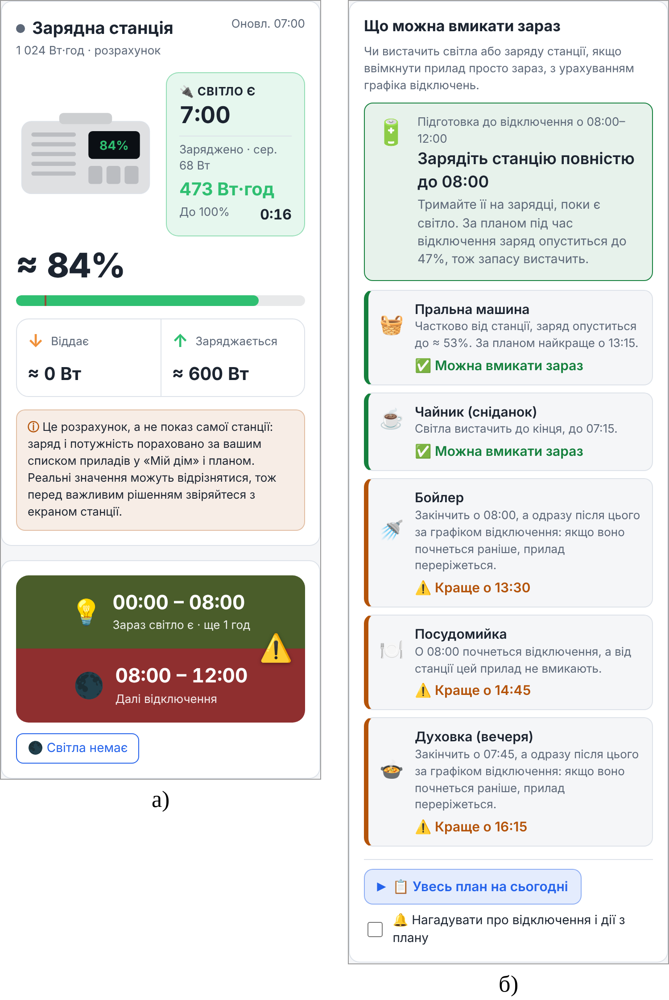
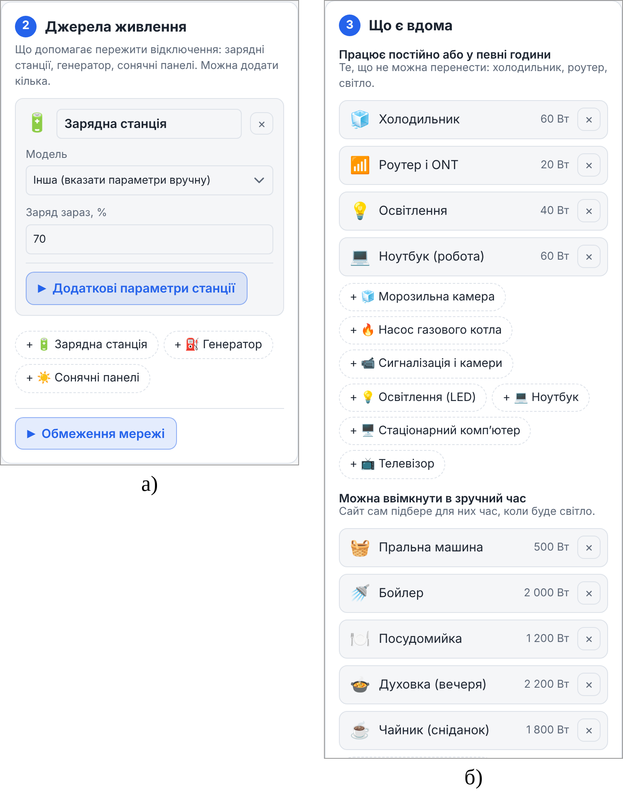
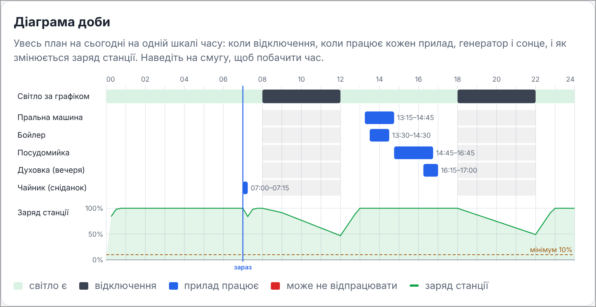
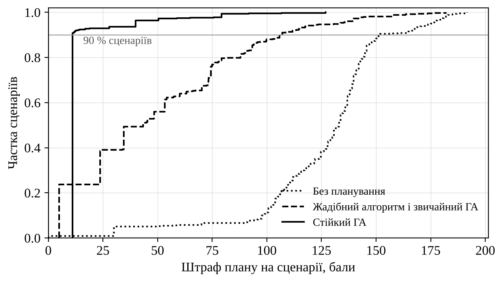
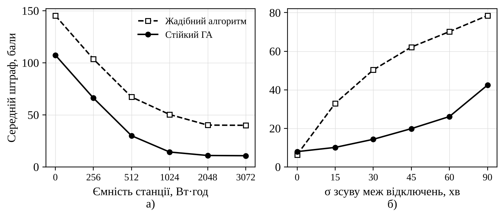
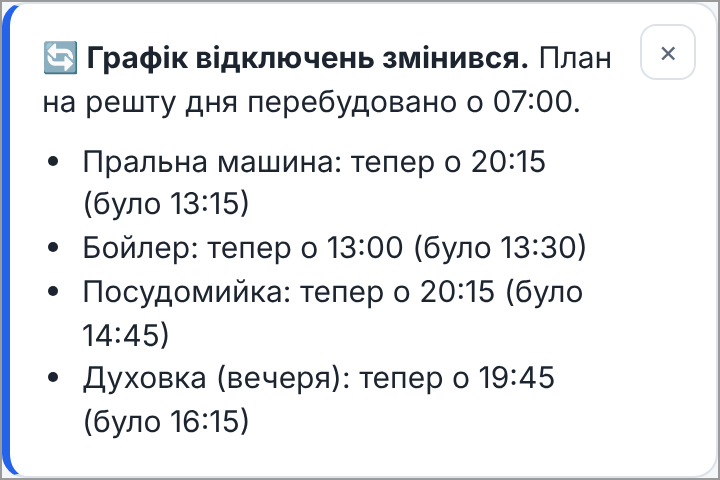
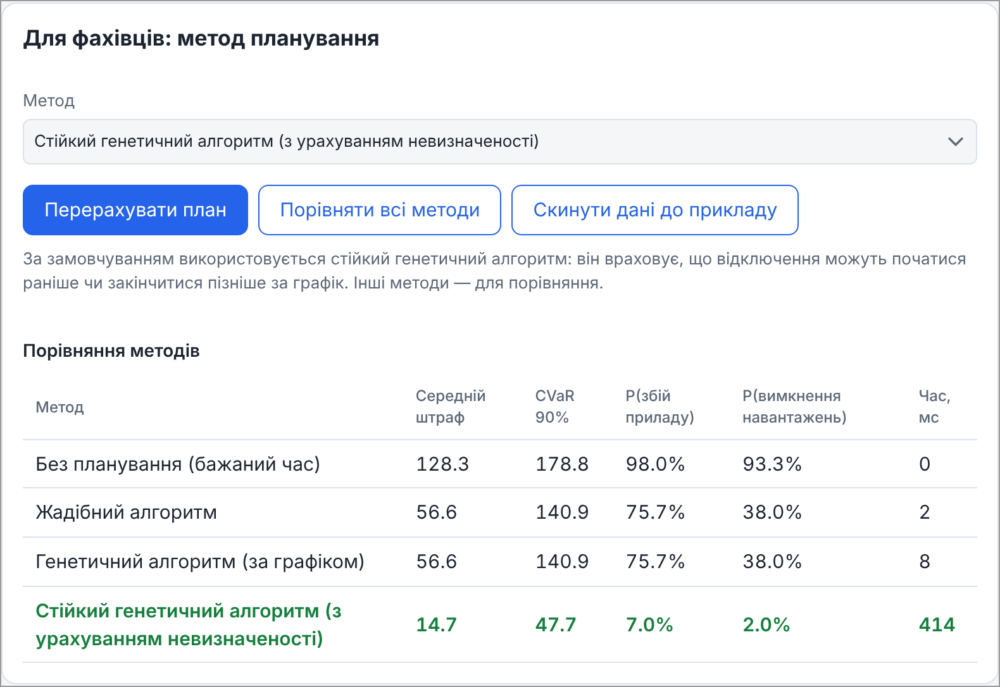

# РОЗДІЛ 3. ПРОГРАМНА РЕАЛІЗАЦІЯ, ТЕСТУВАННЯ ТА ЕКСПЕРИМЕНТАЛЬНЕ ДОСЛІДЖЕННЯ МЕТОДУ

## 3.1 Засоби реалізації

Веб-сервіс і програми експериментів написано мовою JavaScript. Одна мова для всіх частин потрібна через ядро планування: як показано в підрозділі 2.9, той самий код рахує план у браузері користувача, на сервері й у програмах експериментів. Якби ядро було написано іншою мовою, наприклад Python, його довелося б або дублювати в браузері, або рахувати план лише на сервері, а від цього в підрозділі 2.9 відмовилися. Засоби реалізації кожної частини наведено в табл. 3.1.

Таблиця 3.1 – Засоби реалізації веб-сервісу

| Частина | Засоби | Призначення |
|---|---|---|
| Ядро планування | JavaScript (модулі ECMAScript), Node.js 22 | Модель доби, імітація, сценарії, критерій стійкості, алгоритми планування |
| Клієнтська частина | React 19, Vite 8, Web Worker | Інтерфейс, зберігання даних у браузері, розрахунок плану у фоновому потоці |
| Серверна частина | Node.js 22, Express 5 | Програмний інтерфейс: графіки «YASNO», облікові записи, кабінет |
| База даних | PostgreSQL, бібліотека pg | Облікові записи, домогосподарства, графіки, історія планів |
| Експерименти | Node.js, розв'язувач HiGHS | Статистичні експерименти, точний розв'язок задачі змішаного цілочисельного програмування |
| Тестування | Засіб node:test, GitHub Actions | Автоматичні тести і їх запуск після кожної зміни коду |
| Розгортання | Netlify, Render | Розміщення клієнтської частини, сервера і бази даних |

Інтерфейс побудовано на бібліотеці React, у якій сторінка складається з компонентів, а кожен компонент описує свій вигляд залежно від даних [@react]. Сторінки сервісу складаються з однотипних карток (стан станції, графік, порада щодо приладу), тому компонентний підхід тут зручний. Збирач Vite [@vite] перетворює код клієнта на набір статичних файлів, які можна розмістити на будь-якому хостингу. Генетичний алгоритм запускається у фоновому потоці браузера (Web Worker), який виконує скрипт окремо від потоку, що малює сторінку [@whatwg].

Серверну частину написано на Node.js з бібліотекою Express [@express]. Для бази даних обрано реляційну СУБД PostgreSQL, бо структура даних (користувач, домогосподарство, джерела, прилади, графіки, плани) добре лягає на таблиці зі зв'язками, а обмеження цілісності CHECK дають змогу перевіряти коректність даних у самій базі [@postgres]. Тести написано на вбудованому в Node.js засобі node:test, тож окремі бібліотеки для тестування не потрібні [@nodetest]. Для перевірки якості розв'язків в експериментах використано розв'язувач HiGHS [@huangfu] у версії, скомпільованій у WebAssembly, яка працює в Node.js без встановлення додаткових програм.

## 3.2 Структура програмного забезпечення і реалізація ядра планування

Програмний код зберігається в одному репозиторії Git і поділений на три пакети з власними залежностями: ядро, клієнт і сервер. Клієнт і сервер підключають ядро як залежність, а програми експериментів лежать поруч з ядром. Склад репозиторію наведено в табл. 3.2.

Таблиця 3.2 – Склад програмного забезпечення

| Каталог | Вміст | Обсяг, рядків |
|---|---|---|
| `core/src` | Ядро планування: модель, імітація, сценарії, критерій, алгоритми | 1377 |
| `core/experiments` | Програми експериментів і звіти з результатами | 851 |
| `client/src` | Клієнтська частина: сторінки, компоненти, перебудова плану | 5270 (і 2945 рядків стилів) |
| `server/src`, `server/migrations` | Серверна частина і структура бази даних | 1050 і 166 |
| `core/test`, `server/test`, `client/test` | Автоматичні тести | 1345 |
| `research/yasno` | Програма збору графіків «YASNO» | 69 |

Ядро не залежить ні від браузера, ні від сервера: воно отримує опис домогосподарства у вигляді об'єкта JavaScript і повертає план. Модулі ядра і їхній зв'язок з моделлю розділу 2 наведено в табл. 3.3.

Таблиця 3.3 – Модулі ядра планування

| Модуль | Що реалізує | Розділ 2 |
|---|---|---|
| `model.js` | Перетворення опису домогосподарства на модель доби: слоти, маска графіка, вікна приладів, гени генераторів | 2.2, формула (2.1) |
| `sources.js` | Зведення кількох станцій в одну еквівалентну | 2.3 |
| `simulate.js` | Покрокова імітація доби і обчислення штрафу | 2.3, 2.4, формули (2.2)–(2.11) |
| `scenarios.js` | Генерування сценаріїв фактичного графіка | 2.5, формули (2.12), (2.13) |
| `robust.js` | Критерій стійкості та оцінка плану на тестових сценаріях | 2.6, формула (2.14) |
| `algorithms/` | Базові методи (без планування, жадібний), генетичний алгоритм, повний перебір | 2.7 |
| `planner.js` | Побудова плану з поточного моменту, опис плану для інтерфейсу | 2.8, формула (2.16) |
| `milp.js` | Модель задачі змішаного цілочисельного програмування для перевірки | 2.7 |
| `autonomy.js` | Оцінка, на скільки вистачить кожного джерела | 2.9 |
| `random.js`, `stats.js`, `time.js` | Генератор псевдовипадкових чисел, статистичні тести, перетворення часу | – |

Найбільше часу витрачається на імітацію доби. Під час пошуку стійкого плану кожну хромосому імітують на всіх 60 навчальних сценаріях, і за популяції 40 та 120 поколінь це до 288 тис. імітацій по 96 слотів. Тому імітатор написано так, щоб у циклі за слотами не створювалися нові об'єкти: стан станції, генераторів і приладів зберігається в простих змінних і числових масивах, які створюються один раз на виклик, а покроковий слід доби записується лише тоді, коли він потрібен для інтерфейсу. Крім того, генетичний алгоритм запам'ятовує значення критерію для вже оцінених хромосом, бо після схрещування й мутації в популяції часто з'являються однакові плани.

Усі випадкові величини (сценарії, початкова популяція, оператори генетичного алгоритму) беруться з генератора псевдовипадкових чисел із заданим початковим значенням. Нормально розподілені зсуви меж відключень (підрозділ 2.5) отримуються з рівномірно розподілених чисел методом Бокса – Мюллера [@boxmuller]. Тому однакові вхідні дані дають однаковий план, а будь-який експеримент можна повторити і отримати ті самі числа. Без цього було б неможливо реалізувати фіксовану множину навчальних сценаріїв, описану в підрозділі 2.6.

Результатом роботи ядра є об'єкт плану. Він містить час запуску кожного приладу (або позначку, що прилад сьогодні не вмикається), правило запуску генераторів, покрокову імітацію доби за опублікованим графіком і оцінку плану на 300 тестових сценаріях: середній штраф, CVaR, ймовірність того, що якийсь прилад не відпрацює, і ймовірність вимкнення постійних навантажень. Із цього об'єкта клієнт будує всі сторінки, описані нижче, тому інтерфейс не має власних розрахунків, які могли б розійтися з планом.

## 3.3 Реалізація клієнтської та серверної частин

Клієнтська частина складається з п'яти розділів: «Сьогодні», «Мій дім», «Резервне живлення», «Детально» і «Як це працює». Під час першого відкриття сайт пропонує три кроки: вибрати місто і чергу відключень, указати зарядну станцію і відмітити прилади з довідника. Після цього план будується одразу, а всі дані зберігаються в сховищі браузера.

Розділ «Сьогодні» – головний для користувача (рис. 3.1). Угорі показано розрахунковий стан зарядної станції: заряд, потужність, яку вона віддає або отримує, і скільки енергії віддано чи отримано від початку поточного відрізка графіка. Під ним показано поточний і наступний відрізки графіка, наприклад «світло є ще 1 год, далі відключення 08:00–12:00». Кнопки «Світла немає» і «Світло вже є» дають змогу повідомити, що фактичний стан мережі відрізняється від графіка, і тоді план перебудовується, як описано в підрозділі 2.8.

Нижче розміщено блок «Що можна вмикати зараз», логіку якого описано в підрозділі 2.9. Для кожного приладу показано одну з трьох позначок: «Можна вмикати зараз», «Краще о …» з поясненням причини або «Сьогодні краще не вмикати» (рис. 3.1, б). Запас 30 хв до відключення для приладів, які не можна живити від станції, узято з моделі невизначеності: за середнього рівня стандартне відхилення зсуву меж відключення дорівнює саме 30 хв (табл. 2.3). Перед відключенням окремо показується порада, до якого рівня зарядити станцію. Повний план у вигляді списку дій з часом відкривається кнопкою «Увесь план на сьогодні», а вкладка «Завтра» показує план на наступну добу.

У розділі «Мій дім» користувач вводить графік відключень, резервні джерела і прилади (рис. 3.2). Графік для Києва й Дніпра завантажується з «YASNO» за номером черги і оновлюється під час кожного відкриття сайту, для інших міст його вводять вручну. Для зарядних станцій є довідник поширених моделей з ємністю і потужністю, а прилади додаються з довідника типових побутових приладів з потужністю і тривалістю циклу. Детальні параметри (вікно запуску, бажаний час, пріоритет, дозвіл працювати від станції) сховано в розкривний блок, бо для першого плану достатньо значень за замовчуванням.

Розділ «Резервне живлення» відповідає на питання, на скільки вистачить кожного джерела, якщо світло зникне зараз, для вибраного набору споживачів. Цей розрахунок не будує розкладу і потрібен, коли людина хоче швидко оцінити, чи витягне станція, наприклад, обігрівач. Розділ «Детально» містить діаграму доби (рис. 3.3), енергобаланс доби по годинах, показники надійності плану, історію по днях і журнал спостережень користувача про фактичний стан мережі. Журнал можна вивантажити у файл CSV, щоб використати для уточнення моделі невизначеності. Там же є блок для фахівців, де можна вибрати метод планування і порівняти всі методи на даних користувача.

На діаграмі доби в одній шкалі часу показано графік відключень, час роботи кожного приладу і заряд станції. Прилади, які за опублікованим графіком не встигнуть відпрацювати, позначаються червоним. Вертикальна лінія відповідає поточному моменту, і ліворуч від неї показано вже виконану частину плану.

Розрахунок плану запускається у фоновому потоці. Клієнт надсилає потоку дані домогосподарства і отримує готовий план, а сторінка тим часом показує напис «Рахую…» і залишається доступною. Модуль перебудови плану визначає поточний слот τ, фіксує прилади, які вже ввімкнулися, бере заряд станції з попереднього розрахунку і викликає ядро. Якщо змінився графік, клієнт порівнює новий план із попереднім і показує, які прилади перенесено (див. підрозділ 3.11). Нагадування про відключення і про дії з плану реалізовано через сповіщення браузера [@notifications], а сам сайт завдяки файлу маніфесту можна встановити на телефон як застосунок [@manifest].

Серверна частина надає програмний інтерфейс у форматі JSON [@json]. Основні методи наведено в табл. 3.4.

Таблиця 3.4 – Основні методи програмного інтерфейсу сервера

| Метод і шлях | Призначення |
|---|---|
| `GET /api/health` | Перевірка стану сервера |
| `GET /api/sources/yasno/regions` | Перелік регіонів, операторів і черг «YASNO» |
| `GET /api/sources/yasno/schedule` | Графік черги на сьогодні й завтра, перетворений на інтервали відключень |
| `POST /api/plan` | Розрахунок плану на сервері за переданими даними |
| `POST /api/auth/register`, `/login`, `/logout`; `GET /api/auth/me` | Реєстрація, вхід, вихід, поточний користувач |
| `GET`, `POST /api/households`; `GET`, `PUT`, `DELETE /api/households/:id` | Домогосподарства користувача |
| `GET`, `POST /api/households/:id/schedules` | Збережені графіки відключень |
| `GET`, `POST /api/households/:id/plans`; `GET`, `DELETE /api/plans/:id` | Історія планів |

Графік «YASNO» сервер перетворює з формату оператора (інтервали в хвилинах від початку доби з типом «точне» або «можливе» відключення) на інтервали у форматі ядра і вирівнює межі на сітку 15 хв. Відповіді оператора кешуються: графік на 5 хв, перелік регіонів на добу. Дані, що надходять до сервера, перевіряються, і на некоректні дані сервер відповідає кодом 400 з поясненням, що саме не так.

Пароль користувача зберігається у вигляді хешу, обчисленого функцією scrypt [@scrypt] з випадковою сіллю. Після входу сервер створює випадковий токен сесії довжиною 32 байти, передає його браузеру в cookie з ознакою HttpOnly [@cookie], а в базі зберігає лише хеш токена. Структура бази даних (табл. 2.8) задана файлами міграцій, які сервер застосовує автоматично під час запуску. Якщо базу даних не підключено, сервер продовжує віддавати графіки й рахувати плани, а методи кабінету відповідають кодом 503. Інтерфейс кабінету на сайті поки не реалізовано, тому облікові записи доступні через програмний інтерфейс і перевірені автоматичними тестами.

Клієнтську частину розміщено на «Netlify» [@netlify], сервер і базу даних – на «Render» на безкоштовних тарифах. Сервер на безкоштовному тарифі призупиняється, якщо 15 хв не отримує запитів, і перший запит після паузи обробляється до хвилини [@render]. Клієнт у цей час повторює запит, а план, як і раніше, рахує сам, тож для користувача пауза помітна лише як затримка оновлення графіка.

## 3.4 Тестування програмного забезпечення

Програмне забезпечення перевіряється автоматичними тестами трьох частин (табл. 3.5). Більшість тестів сформульовано як твердження про поведінку моделі, які можна перевірити вручну: наприклад, прилад, який не можна живити від станції, переривається, якщо відключення почалося під час його роботи.

Таблиця 3.5 – Автоматичні тести

| Частина | Тестів | Що перевіряється |
|---|---|---|
| Ядро | 42 | Перетворення часу і графіка на слоти; переривання приладів відключенням; заряджання і розряджання станції; ліміт мережі; генератор за пороговим правилом і витрата пального; сонячна генерація; перебудова плану з поточного моменту і план на 48 год; відтворюваність сценаріїв; обчислення CVaR; дотримання вікон приладів усіма методами; перевага стійкого ГА над звичайним на тестових сценаріях; збіг ГА з оптимумом MILP на демонстраційній задачі; тест Вілкоксона; розрахунок автономності |
| Сервер | 23 | Відповіді програмного інтерфейсу і перевірка даних; перетворення і кешування графіків «YASNO»; реєстрація і вхід; збереження домогосподарства з кількома джерелами без втрат; недоступність чужих даних; збереження графіків і історії планів |
| Клієнт | 32 | Перебудова плану з поточного моменту без зсуву вже ввімкнених приладів; уточнення графіка повідомленнями «Світла немає» і «Світло вже є»; поради «Що можна вмикати зараз»; розрахунковий стан станції; сонячна генерація; перенесення даних зі старого формату; зрозумілі повідомлення про помилки в даних |

Разом 97 тестів. Дев'ять серверних тестів працюють з базою даних і виконуються, коли задано адресу тестової бази PostgreSQL. Тести запускаються в системі неперервної інтеграції GitHub Actions [@ghactions] після кожної зміни коду: вона встановлює залежності, піднімає тестову базу PostgreSQL, виконує всі тести і збирає клієнтську частину. Результат перевірки видно в кожному запиті на злиття змін, тому помилку помітно ще до того, як зміна потрапить до основної гілки.

Під час написання тестів клієнтської частини знайдено кілька помилок, які складно помітити, переглядаючи сайт вручну. Наприклад, під час повторних оновлень сторінки в межах одного 15-хвилинного слоту заряд станції щоразу зменшувався, бо план перебудовувався з уже зменшеного заряду. Інша помилка стосувалася порад: сервіс радив увімкнути прилад, який за опублікованим графіком не встигав відпрацювати до відключення. Після виправлення такий прилад знімається з плану на сайті. В експериментах цієї обробки немає, щоб методи порівнювалися в однакових умовах.

Окремо перевірено правильність самого методу. На малих задачах результат генетичного алгоритму порівнюється з оптимумом, знайденим повним перебором, а на більших – з нижньою оцінкою, отриманою розв'язувачем HiGHS (підрозділ 3.7).

## 3.5 Методика експериментального дослідження

Метою експериментів є перевірка того, чи зменшує запропонований метод ризик переривання приладів і вимкнення постійних навантажень порівняно з базовими методами. Порівнювалися чотири методи:

– без планування: кожен прилад вмикається в бажаний час, а генератор, якщо він є, вмикається за типовим правилом, коли заряд станції падає до 30 %;

– жадібний алгоритм: прилади по черзі, від важливіших і потужніших, ставляться на найкращий час за опублікованим графіком;

– звичайний генетичний алгоритм, який оптимізує штраф (2.11) за опублікованим графіком;

– стійкий генетичний алгоритм, який оптимізує критерій (2.14).

Основною тестовою задачею є демонстраційна квартира з табл. 3.6. Постійні навантаження в ній – холодильник (60 Вт, пріоритет 5), роутер (20 Вт, пріоритет 4), освітлення з 17:00 до 23:30 (40 Вт, пріоритет 3) і ноутбук з 09:00 до 18:00 (60 Вт, пріоритет 4). Є зарядна станція ємністю 1024 Вт·год з інвертором 1800 Вт і заряджанням 600 Вт, мінімальний заряд 10 %, на початку доби заряд 70 %. Ліміт вводу мережі 5 кВт. Опублікований графік містить два відключення: 08:00–12:00 і 18:00–22:00.

Таблиця 3.6 – Зсувні прилади демонстраційної квартири

| Прилад | Потужність, Вт | Цикл, хв | Вікно | Бажаний час | Пріоритет | Від станції |
|---|---|---|---|---|---|---|
| Пральна машина | 500 | 90 | 07:00–23:00 | 19:00 | 3 | так |
| Бойлер | 2000 | 60 | 05:00–22:00 | 06:30 | 4 | ні |
| Посудомийка | 1200 | 120 | 12:00–24:00 | 20:00 | 2 | ні |
| Духовка | 2200 | 45 | 16:00–20:30 | 18:30 | 4 | ні |
| Чайник | 1800 | 15 | 07:00–09:30 | 08:15 | 3 | так |

Крім базової задачі, використано три її варіанти: з трьома відключеннями на добу (00:00–04:00, 08:00–12:00, 16:00–20:00), без зарядної станції і зі станцією 2048 Вт·год. Кожну з чотирьох задач розв'язано за трьох рівнів невизначеності з табл. 2.3, тобто всього 12 конфігурацій.

Плани всіх методів оцінювалися на одній і тій самій тестовій множині з 500 сценаріїв, згенерованих з початковим значенням генератора, відмінним від навчального. Стійкий генетичний алгоритм навчався на 60 інших сценаріях, як описано в підрозділі 2.6. Обидва генетичні алгоритми запускалися з 10 різними початковими значеннями генератора, щоб перевірити, чи залежить результат від випадку. Для кожного плану обчислено чотири показники: середній штраф, CVaR_{0,9} штрафу, ймовірність того, що хоча б один прилад не відпрацює (далі ймовірність збою приладу), і ймовірність того, що доведеться вимкнути хоча б одне постійне навантаження.

Плани порівнювалися попарно на тих самих сценаріях, тому для перевірки значущості різниці використано парний знаково-ранговий критерій Вілкоксона [@wilcoxon]. Він не вимагає нормального розподілу різниць, а розподіл штрафу тут явно не нормальний: у більшості сценаріїв штраф малий, а в частині сценаріїв великий через зіпсований цикл приладу. Розмір ефекту оцінено, як рекомендовано в [@fritz], за формулою

r = |z| / √n, (3.1)

де z – нормована статистика критерію Вілкоксона;

n – кількість пар (n = 500).

Значення r близько 0,1 вважають малим ефектом, 0,3 – середнім, 0,5 – великим [@fritz].

Усі експерименти виконуються програмами з каталогу `core/experiments`, які записують результати у звіти у форматі Markdown. Оскільки всі випадкові величини задані початковими значеннями генератора, повторний запуск дає ті самі значення штрафу і ймовірностей. Під час підготовки цього розділу всі експерименти було перезапущено на поточній версії ядра, і відрізнявся лише час роботи, який залежить від комп'ютера.

## 3.6 Порівняння методів планування

Результати для базової задачі за трьох рівнів невизначеності наведено в табл. 3.7.

Таблиця 3.7 – Результати методів для базової задачі

| Невизначеність | Метод | Середній штраф | CVaR_{0,9} | Збій приладу, % | Вимкнення постійних, % |
|---|---|---|---|---|---|
| Низька | Без планування | 130,08 | 147,92 | 100,0 | 97,2 |
| Низька | Жадібний | 35,17 | 88,84 | 67,0 | 32,8 |
| Низька | Звичайний ГА | 35,17 | 88,84 | 67,0 | 32,8 |
| Низька | Стійкий ГА | 9,19 | 20,34 | 2,0 | 2,8 |
| Середня | Без планування | 125,73 | 173,87 | 99,2 | 92,6 |
| Середня | Жадібний | 50,33 | 132,10 | 76,2 | 35,6 |
| Середня | Звичайний ГА | 50,33 | 132,10 | 76,2 | 35,6 |
| Середня | Стійкий ГА | 14,32 | 44,00 | 7,0 | 2,0 |
| Висока | Без планування | 112,24 | 187,94 | 94,8 | 73,8 |
| Висока | Жадібний | 69,76 | 177,21 | 79,0 | 40,4 |
| Висока | Звичайний ГА | 69,76 | 177,21 | 79,0 | 40,4 |
| Висока | Стійкий ГА | 27,04 | 75,77 | 33,8 | 5,6 |

Без планування майже в кожному сценарії хоча б один прилад не відпрацьовує, бо бажаний час бойлера, духовки і чайника припадає на відключення. Жадібний алгоритм і звичайний ГА розставляють прилади на час, коли за графіком є світло, і зменшують середній штраф у 1,6–3,7 раза. Однак вони ставлять прилади впритул до відключень, і за середньої невизначеності в 76 % сценаріїв якийсь прилад все одно не встигає відпрацювати. Стійкий ГА залишає запас часу між циклами приладів і межами відключень і заряджає станцію з урахуванням того, що відключення може затягтися. У результаті за середньої невизначеності ймовірність збою приладу зменшується з 76,2 до 7,0 %, а ймовірність вимкнення постійних навантажень – з 35,6 до 2,0 %.

Розподіл штрафу на тестових сценаріях для базової задачі показано на рис. 3.4. Різниця між методами найбільша в правій частині розподілу, тобто в несприятливих сценаріях: у 10 % найгірших сценаріїв середній штраф стійкого ГА становить 44,00 проти 132,10 у жадібного алгоритму. Саме на зменшення таких випадків розрахований доданок CVaR у критерії (2.14).

Звичайний ГА в усіх конфігураціях дає той самий план, що й жадібний алгоритм. Причина в тому, що жадібний план входить у початкову популяцію генетичного алгоритму (підрозділ 2.7), а для опублікованого графіка він здебільшого вже оптимальний: на малих задачах підрозділу 3.7 жадібний алгоритм знайшов оптимум у 19 з 20 випадків. Отже, весь виграш стійкого ГА зумовлений урахуванням невизначеності, а не кращим пошуком. Це узгоджується з тим, що звичайний і стійкий варіанти відрізняються лише критерієм.

Результати для інших задач за середньої невизначеності наведено в табл. 3.8. Звичайний ГА в таблиці не показано, бо його результати збігаються з результатами жадібного алгоритму.

Таблиця 3.8 – Середній штраф і ймовірність збою приладу для різних задач за середньої невизначеності

| Задача | Без планування | Жадібний | Стійкий ГА | Збій приладу: жадібний / стійкий ГА, % |
|---|---|---|---|---|
| Базова | 125,73 | 50,33 | 14,32 | 76,2 / 7,0 |
| Три відключення на добу | 94,20 | 78,19 | 30,03 | 100,0 / 58,6 |
| Без зарядної станції | 202,96 | 145,33 | 107,42 | 76,2 / 10,0 |
| Станція 2048 Вт·год | 60,41 | 29,29 | 8,50 | 66,0 / 4,2 |

У задачі з трьома відключеннями світло є лише 12 год на добу, і вікна приладів майже не мають вільного місця, тому навіть стійкий план у 58,6 % сценаріїв не рятує якийсь прилад. Проте середній штраф і тут менший у 2,6 раза. Без зарядної станції постійні навантаження вимикаються в кожному відключенні за будь-якого плану, і цей штраф однаковий для всіх методів. Тому відносний виграш менший, хоча ймовірність збою приладу зменшується з 76,2 до 10,0 %.

Перевага стійкого ГА над жадібним алгоритмом статистично значуща в усіх 12 конфігураціях (критерій Вілкоксона, p < 0,001). Розмір ефекту за формулою (3.1) становить від 0,47 (станція 2048 Вт·год, низька невизначеність) до 0,86 (три відключення, середня невизначеність), тобто в усіх випадках ефект середній або великий. Для базової задачі за середньої невизначеності стійкий план кращий у 373 сценаріях з 500 і гірший у 127. Найімовірніше, програші припадають на сценарії, де межі відключень майже не зсунулися: тоді запас часу, залишений стійким планом, виявляється зайвим, а прилад вмикається далі від бажаного часу.

Результат генетичного алгоритму не залежить від початкового значення генератора. У всіх 24 конфігураціях (12 конфігурацій для кожного з двох варіантів ГА) усі 10 запусків привели до одного й того самого плану. Відрізнялися лише час роботи і кількість обчислень критерію.

Побудова стійкого плану на добу в експериментах займала 0,14–0,19 с, а звичайного ГА – близько 3 мс. Стійкий ГА працює приблизно в 50 разів довше, бо кожен план оцінюється на 60 сценаріях замість одного. На повільнішому комп'ютері під час повторного запуску час збільшився приблизно втричі, але співвідношення залишилося тим самим. Для веб-сервісу такий час прийнятний, тим більше що розрахунок виконується у фоновому потоці.

## 3.7 Порівняння з точним розв'язком

Щоб перевірити, наскільки генетичний алгоритм близький до оптимуму, використано два способи. Перший – повний перебір на малих задачах. Згенеровано 20 випадкових задач з трьома приладами (пральна машина, бойлер, посудомийка), вікнами 2–4 год, одним-двома відключеннями і станцією в половині задач. Медіанна кількість планів у такій задачі становить 2688, тому перебір займає частки секунди. Для кожної задачі генетичний алгоритм запускався з 10 початковими значеннями генератора, тобто всього 200 запусків для кожного критерію. Результати наведено в табл. 3.9.

Таблиця 3.9 – Відхилення генетичного алгоритму від оптимуму на малих задачах

| Показник | Звичайний ГА (штраф за графіком) | Стійкий ГА (критерій (2.14)) |
|---|---|---|
| Запусків, що знайшли оптимум | 191 з 200 (95,5 %) | 199 з 200 (99,5 %) |
| Середнє відносне відхилення від оптимуму | 0,17 % | менше 0,01 % |
| Найбільше абсолютне відхилення, бала | 0,075 | 0,225 |
| Частка планів, які переглянув ГА | 16,9 % | 17,8 % |
| Задач, у яких жадібний алгоритм знайшов оптимум | 19 з 20 | 0 з 20 |

Генетичний алгоритм майже завжди знаходить оптимум, переглянувши менше п'ятої частини всіх планів. Останній рядок таблиці ще раз показує різницю між критеріями: для штрафу за опублікованим графіком жадібний алгоритм майже завжди оптимальний, а за стійким критерієм не знайшов оптимуму в жодній задачі.

Другий спосіб – порівняння з розв'язком задачі змішаного цілочисельного лінійного програмування (MILP), як у системі «EMHASS» [@emhass]. Задачу на опублікованому графіку записано у вигляді MILP і розв'язано розв'язувачем HiGHS [@huangfu]. У MILP-моделі розв'язувач сам вибирає, коли заряджати станцію і які навантаження вимикати, тоді як імітатор робить це за фіксованими правилами (підрозділ 2.3). Тому оптимум MILP є нижньою оцінкою штрафу: жоден план не може бути кращим за неї. Перевірка проводилася на чотирьох задачах з табл. 3.8 і на 20 випадкових задачах із шістьма приладами.

Генетичний алгоритм досяг нижньої оцінки MILP в усіх чотирьох задачах і в усіх 20 випадкових задачах. Отже, на цих задачах план ГА є доведено оптимальним для опублікованого графіка. Жадібний алгоритм на випадкових задачах із шістьма приладами дав середній штраф 8,78 проти оптимального 5,15. Розв'язок MILP для задачі на добу займав від 6 до 90 мс.

Найважливіший результат цього порівняння полягає в іншому. Точно оптимальний для опублікованого графіка план MILP було перевірено на тих самих 500 тестових сценаріях за середньої невизначеності. Для базової задачі його середній штраф становить 50,33 проти 14,32 у стійкого ГА, а ймовірність збою приладу – 76,2 % проти 7,0 % (p < 0,001). Для інших трьох задач картина така сама. Отже, у задачі цієї роботи важливіше врахувати невизначеність графіка, ніж знайти точний оптимум детермінованої задачі. Це додатково обґрунтовує вибір генетичного алгоритму з імітацією на сценаріях замість лінійного програмування за опублікованим графіком.

## 3.8 Керування генератором і перебудова плану

Для перевірки моделі генератора використано квартиру зі станцією 1024 Вт·год і бензиновим генератором потужністю 2,5 кВт, якого на повному баку при половинному навантаженні вистачає на 8 год. Графік містить два довгі відключення, 07:00–13:00 і 17:00–23:00. Час приладів в усіх варіантах підбирав стійкий ГА, а змінювалося лише правило запуску генератора. Результати наведено в табл. 3.10.

Таблиця 3.10 – Порівняння правил керування генератором

| Керування генератором | Середній штраф | CVaR_{0,9} | Збій приладу, % | Пальне, бака | Генератор, год |
|---|---|---|---|---|---|
| Без генератора | 42,19 | 100,40 | 64,6 | 0 | 0 |
| Генератор на все відключення | 21,41 | 60,52 | 25,8 | 0,49 | 6,1 |
| Вмикати при заряді станції 30 % | 30,15 | 66,45 | 44,7 | 0,23 | 1,8 |
| Поріг підбирає стійкий ГА | 20,51 | 53,96 | 26,2 | 0,53 | 6,2 |

Типове правило «вмикати генератор, коли станція розрядилася до 30 %» економить пальне, але поріг, підібраний стійким ГА, дає на 32 % менший середній штраф (p < 0,001). Генератор, увімкнений пізно, вже не встигає зарядити станцію до кінця відключення, і прилади, які залежать від станції, перериваються. У цій задачі ГА вибрав поріг 100 %, тобто запуск генератора на початку відключення, бо обидва відключення довгі, а палива вистачає. Вибраний варіант дещо кращий і за просте правило «генератор на все відключення», зокрема за CVaR (53,96 проти 60,52). Якщо ж станції немає, ГА вибирає роботу генератора на все відключення, бо без станції іншого джерела під час відключення немає.

Перебудову плану протягом доби перевірено так. Зранку план складено стійким ГА за графіком 08:00–12:00 і 18:00–22:00, а о 12:00 графік змінюється. Порівнюються два варіанти: ранковий план виконується далі або план на решту доби перебудовується з урахуванням уже ввімкнених приладів і заряду станції на 12:00 (підрозділ 2.8). Обидва варіанти оцінено на сценаріях невизначеності навколо нового графіка. Результати наведено в табл. 3.11.

Таблиця 3.11 – Ефект перебудови плану після зміни графіка о 12:00

| Зміна графіка | Штраф без перебудови | Штраф з перебудовою | Зменшення штрафу |
|---|---|---|---|
| Вечірнє відключення зсунуто на 2 год пізніше | 11,08 | 6,67 | 39,8 % |
| Вечірнє відключення подовжено на 1,5 год | 13,31 | 13,32 | –0,1 % |
| Додано денне відключення 14:00–17:00 | 94,46 | 47,21 | 50,0 % |
| Вечірнє відключення скасовано | 9,56 | 1,94 | 79,7 % |

У трьох випадках з чотирьох перебудова зменшує штраф на 40–80 %. Найбільше вона допомагає, коли додано нове відключення: ранковий план ставить прилади саме на цей час. Коли вечірнє відключення лише подовжилося, ранковий план уже має запас, і перебудова його практично не змінює. Ці результати показують, що стійкий план і перебудова доповнюють одне одного: стійкість зменшує шкоду від змін, про які ще не відомо, а перебудова використовує зміни, про які вже стало відомо.

## 3.9 Аналіз чутливості

Аналіз чутливості проведено на базовій задачі за середньої невизначеності: у кожній серії змінювався лише один параметр. Виграш стійкого ГА відносно жадібного алгоритму обчислено як

G = (J_{ж} − J_{с}) / J_{ж} · 100 %, (3.2)

де J_{ж} – середній штраф плану жадібного алгоритму;

J_{с} – середній штраф плану стійкого ГА.

Залежність штрафу від ємності станції і від величини невизначеності графіка показано на рис. 3.5.

Виграш зростає зі збільшенням ємності станції: без станції він становить 26,1 %, для станції 512 Вт·год – 55,4 %, а починаючи з 1024 Вт·год виходить на рівень 71–73 %. Пояснення таке: станція дає планові свободу, бо прилади можна частково живити від неї, і стійкий ГА використовує цю свободу, щоб створити запас на випадок зсуву відключення. Без станції така свобода є лише у виборі часу запуску.

Залежність від невизначеності немонотонна. Якщо межі відключень не зсуваються (σ = 0, залишаються лише рідкі скасування і позапланові відключення), стійкий план на 24,8 % гірший за жадібний, бо залишає запас часу, який не знадобився. Отже, запропонований метод має сенс лише тоді, коли графік справді змінюється. За σ від 15 до 60 хв виграш становить 63–72 %, а за σ = 90 хв зменшується до 45,9 %, бо за таких великих зсувів частину приладів не вдається захистити жодним планом. Як показано в підрозділі 3.10, у реальних графіках межа відключення, якщо вона зсувається, зсувається в середньому на 43 хв, тобто в зоні найбільшого виграшу.

Вплив кількості навчальних сценаріїв N і ваги ризику λ наведено в табл. 3.12.

Таблиця 3.12 – Вплив кількості навчальних сценаріїв і ваги ризику

| Параметр | Значення | Середній штраф | CVaR_{0,9} | Збій приладу, % |
|---|---|---|---|---|
| N | 5 | 22,42 | 89,13 | 20,4 |
| N | 10 | 20,82 | 94,36 | 20,8 |
| N | 20 і 40 | 15,24 | 64,82 | 10,0 |
| N | 60 і 100 | 14,32 | 44,00 | 7,0 |
| N | 200 | 14,30 | 41,10 | 7,0 |
| λ | 0 | 14,70 | 54,08 | 10,0 |
| λ | від 0,25 до 4 | 14,32 | 44,00 | 7,0 |

За малої кількості сценаріїв алгоритм підлаштовується під них, і на тестових сценаріях план гірший. Починаючи з N = 60 результат практично не змінюється, а час розрахунку зростає пропорційно N. Тому значення N = 60 з підрозділу 2.6 є компромісом між якістю плану і часом розрахунку. Без доданка CVaR (λ = 0) середній штраф майже такий самий, але CVaR і ймовірність збою помітно більші. Будь-яке λ від 0,25 до 4 дає той самий план, тож результат мало залежить від точного значення ваги ризику.

## 3.10 Зміни графіків «YASNO» за період дослідження

Модель невизначеності з підрозділу 2.5 задано експертно, тому паралельно з розробкою збиралися реальні графіки. Програма збору кожні 30 хв завантажує графіки всіх черг Києва і Дніпра з відкритого програмного інтерфейсу «YASNO» [@yasno] і зберігає кожну нову версію. За період з 15 жовтня по 22 листопада 2026 року (39 діб) зібрано понад 250 знімків, кожен з яких містить графіки всіх черг на сьогодні й завтра. Як і в підрозділі 1.1, одиницею підрахунку є добовий графік однієї черги. Графік вважається зміненим, якщо після першої публікації для тієї самої доби з'явилася версія з іншим статусом або іншими інтервалами. Результати наведено в табл. 3.13.

Таблиця 3.13 – Зміни опублікованих графіків «YASNO» з 15.10 по 22.11.2026

| Оператор | Опубліковано графіків | Змінено після публікації | Замінено аварійними | Скасовано | Зсув меж до 1,5 год | Інші інтервали |
|---|---|---|---|---|---|---|
| Київ, ДТЕК Київські електромережі | 2337 | 1037 (44 %) | 420 | 0 | 356 | 261 |
| Дніпро, ДнЕМ | 264 | 176 (67 %) | 32 | 35 | 18 | 91 |
| Дніпро, ЦЕК | 262 | 87 (33 %) | 20 | 0 | 8 | 59 |

У Києві після публікації змінилося 44 % графіків, тобто частка змін за весь період близька до 40 %, отриманих за перші п'ять днів збору. Зміни бувають трьох видів. Найчастіше графік замінюють аварійними відключеннями (420 випадків), коли опублікований графік перестає діяти. У 356 випадках відключення залишаються тими самими, але зсуваються їхні межі. Зсув завжди кратний 30 хв і в середньому становить 43 хв, що відповідає середньому рівню невизначеності моделі (σ = 30 хв, найбільший зсув 90 хв). У решті 261 випадку відключення додаються або прибираються.

Ці дані підтверджують головне припущення роботи: графік, за яким планує домогосподарство, часто змінюється, і план, складений лише під опублікований графік, ризикований. Водночас вони показують і обмеження моделі. По-перше, у Києві зміни майже завжди подовжують відключення: з 617 неаварійних змін сумарна тривалість відключень зросла в 552 випадках. Модель же вважає зсуви симетричними. По-друге, заміну графіка аварійними відключеннями модель описує лише як рідке позапланове відключення тривалістю 1–3 год. Тому значення ймовірностей у табл. 3.7 слід розглядати як порівняльні, а не як прогноз для конкретного міста. Уточнення моделі на цих даних, зокрема несиметричний зсув і окремий сценарій аварійних відключень, є напрямом подальшої роботи. Як зазначено в підрозділі 2.5, для цього не потрібно змінювати метод, достатньо замінити процедуру генерування сценаріїв.

## 3.11 Дослідна експлуатація веб-сервісу

Роботу сервісу перевірено на демонстраційній квартирі з табл. 3.6 так, як це бачить користувач. Сайт відкрито о 07:00, коли до першого відключення залишається година. План будується з поточного моменту на 48 год, тому показники надійності на сторінці відрізняються від табл. 3.7, де горизонт становить одну добу.

У розділі «Сьогодні» (див. рис. 3.1) сервіс радить зарядити станцію повністю до 08:00 і повідомляє, що під час відключення заряд опуститься до 47 %. Чайник і пральну машину можна вмикати зараз: чайник встигне до відключення, а пральна машина частково працюватиме від станції. Бойлер, посудомийку і духовку від станції живити не можна, і цикл бойлера закінчився б саме тоді, коли за графіком почнеться відключення. Тому для них сервіс радить інший час, 13:30, 14:45 і 16:15, тобто після денного відключення і до вечірнього, з запасом від обох.

Далі перевірено реакцію на зміну графіка. Вечірнє відключення в графіку перенесено з 18:00–22:00 на 15:00–19:00, як це буває, коли оператор публікує нову версію. Сервіс перебудував план з поточного моменту і показав, які прилади перенесено (рис. 3.6). Пральну машину і посудомийку перенесено на 20:15, після вечірнього відключення, духовку – з 16:15 на 19:45, а бойлер – з 13:30 на 13:00, щоб він закінчив роботу до нового відключення з запасом. Повідомлення з переліком перенесень важливе, бо людина, яка вже запам'ятала попередні поради, інакше не помітить, що вони змінилися.

{105}

Блок «Для фахівців» у розділі «Детально» дає змогу порівняти всі методи на даних користувача (рис. 3.7). Для демонстраційної квартири на 300 тестових сценаріях стійкий ГА дає середній штраф 14,7 проти 56,6 у жадібного алгоритму і зменшує ймовірність збою приладу з 75,7 до 7,0 %. Ці значення близькі до результатів табл. 3.7, отриманих на 500 сценаріях, отже метод у браузері працює так само, як у програмах експериментів.

Під час перевірки розрахунок плану на 48 год у браузері тривав близько 2 с (показник «Час розрахунку» в розділі «Детально»), і завдяки фоновому потоку сторінка в цей час не зупинялася. У звичайному режимі графік не вводиться вручну, а завантажується з «YASNO» за номером черги. Тоді після зміни графіка оператором план перебудовується так само, як на рис. 3.6, під час наступної перевірки, яка відбувається кожні 10 хв, поки сторінка відкрита.

Повідомлення «Світла немає» і «Світло вже є» не лише перебудовують план, а й накопичуються в журналі спостережень. За тривалої експлуатації цей журнал дає те, чого немає в даних «YASNO»: фактичний час відключень для конкретного дому. Разом з даними з підрозділу 3.10 він може бути використаний для уточнення моделі невизначеності.

## Висновки до розділу 3

Веб-сервіс реалізовано мовою JavaScript з одним ядром планування для браузера, сервера і програм експериментів. Ядро містить близько 1,4 тис. рядків коду, а весь програмний код разом з тестами і програмами експериментів – близько 10 тис. рядків без урахування стилів. План рахується в браузері у фоновому потоці, тому сервіс працює і без зв'язку з сервером. Користувач бачить не розклад на добу, а пораду щодо кожного приладу на поточний момент і стан станції. Правильність програми перевіряють 97 автоматичних тестів, які запускаються після кожної зміни коду.

Експерименти на 12 конфігураціях показали, що стійкий генетичний алгоритм зменшує середній штраф порівняно з жадібним алгоритмом і звичайним ГА в усіх конфігураціях, а різниця статистично значуща (p < 0,001) з середнім або великим розміром ефекту. Для демонстраційної квартири за середньої невизначеності ймовірність того, що якийсь прилад не відпрацює, зменшується з 76,2 до 7,0 %, а ймовірність вимкнення постійних навантажень – з 35,6 до 2,0 %. Увесь виграш зумовлений урахуванням невизначеності: звичайний ГА дає той самий план, що й жадібний алгоритм.

Генетичний алгоритм знаходить оптимум на малих задачах у 95,5–99,5 % запусків і досягає нижньої оцінки MILP на всіх перевірених задачах. Водночас план, точно оптимальний для опублікованого графіка, на сценаріях невизначеності для базової задачі має в 3,5 раза більший штраф, ніж стійкий план. Підбір порогу генератора зменшує штраф на 32 % порівняно з правилом «вмикати при 30 %», а перебудова плану після зміни графіка – на 40–80 % у трьох випадках з чотирьох.

Метод дає найбільший виграш для станцій від 1 кВт·год і зсувів меж відключень від 15 до 60 хв. Якщо графік виконується точно, стійкий план гірший за жадібний, тож метод доцільний саме за невизначеного графіка. Аналіз 2337 графіків «YASNO» для Києва показав, що 44 % з них змінюються після публікації, а межі зсуваються в середньому на 43 хв. Це підтверджує актуальність задачі, але також показує, що реальні зміни частіше подовжують відключення, ніж скорочують. Уточнення моделі невизначеності на зібраних даних є напрямом подальшої роботи.
